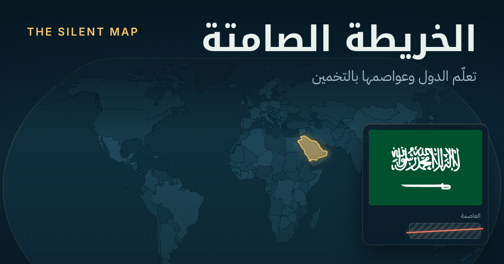
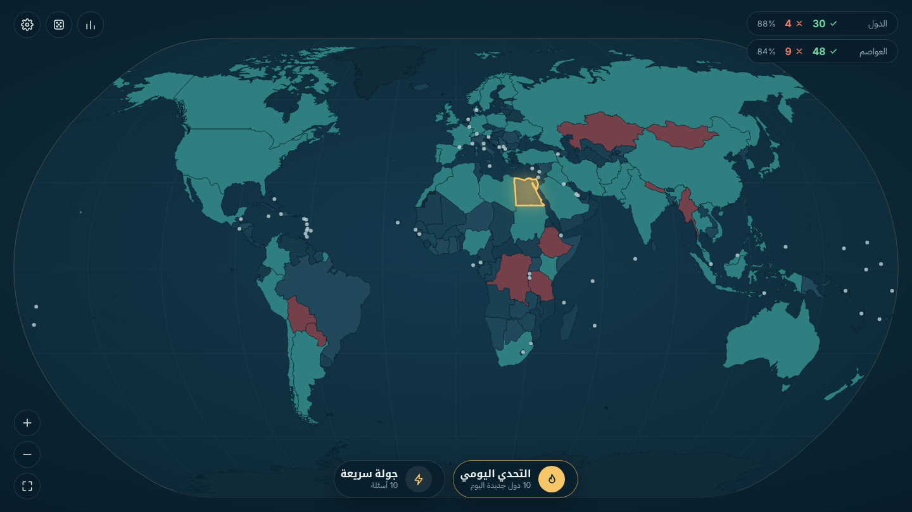
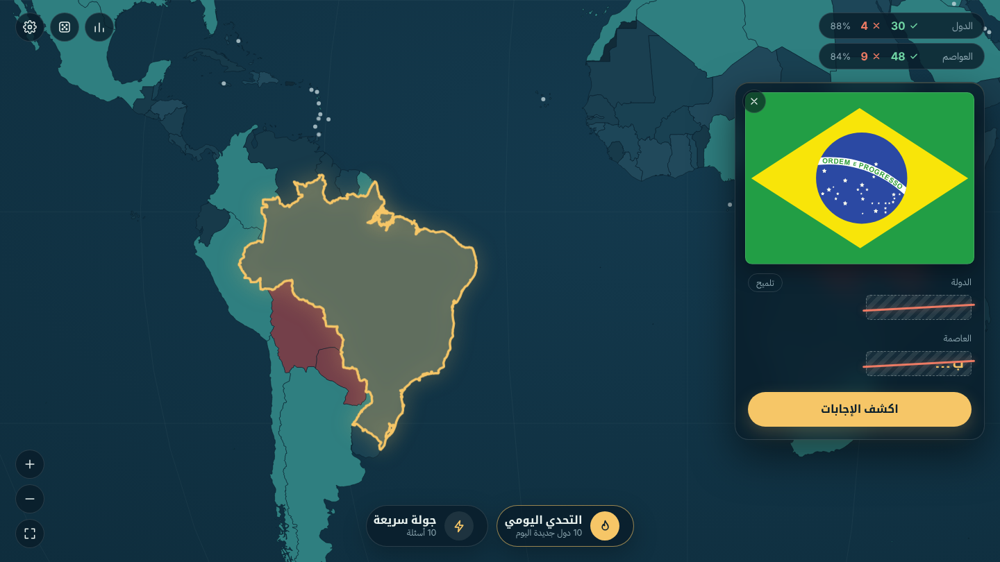
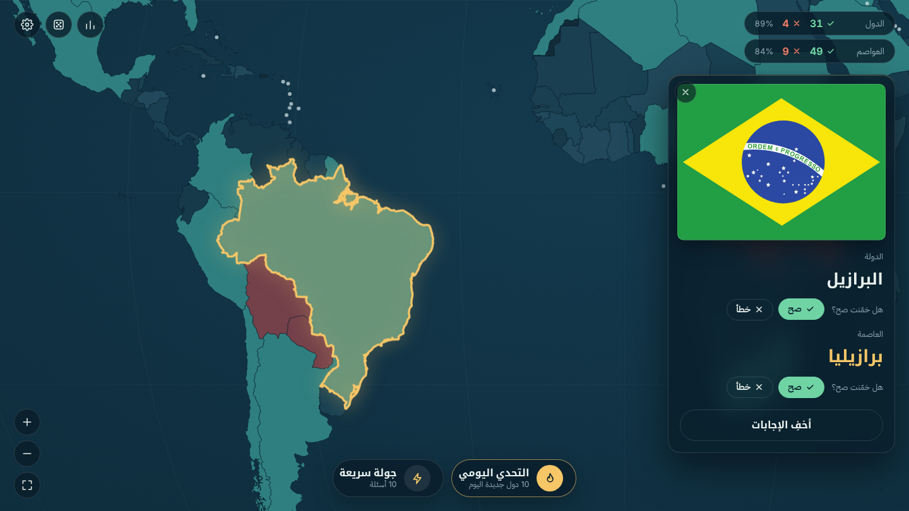
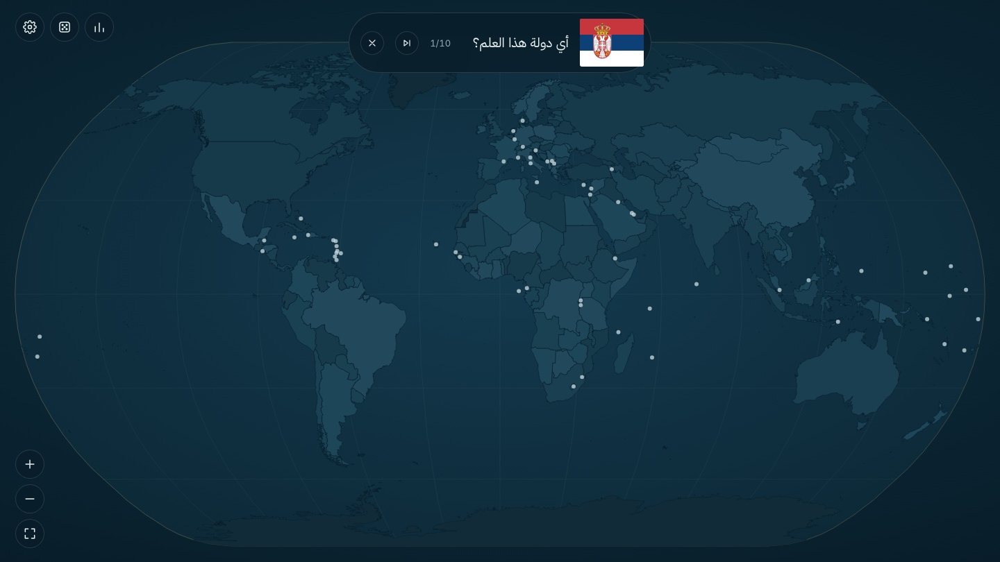
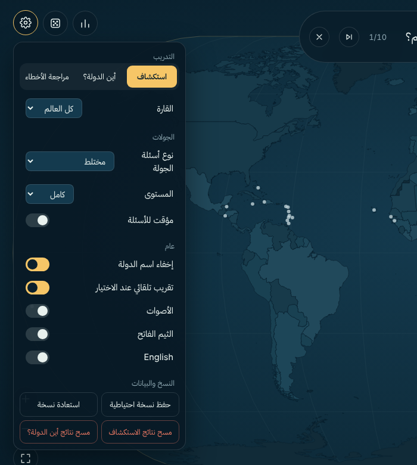
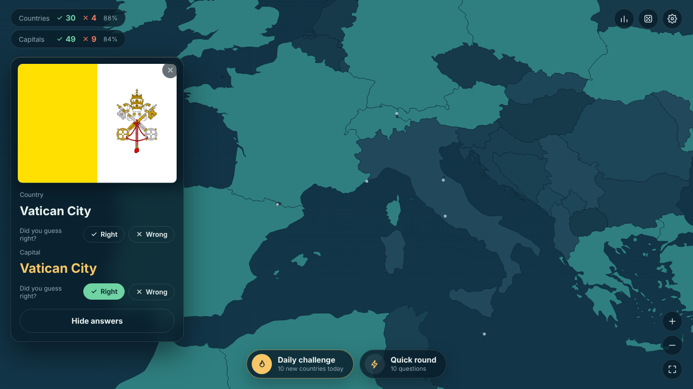
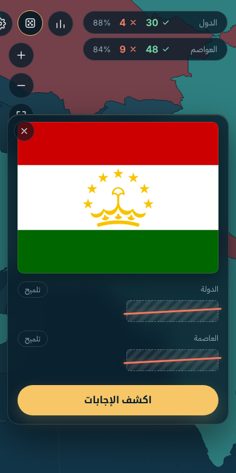

<div align="center">



# TerraTrail

**خريطة العالم الصامتة: اختبر نفسك في الدول وعواصمها**
**The silent world map: quiz yourself on countries and capitals**

### [🌍 جرّب الموقع · Live demo](https://3zuu.github.io/TerraTrail/)

[العربية](#العربية) · [English](#english)

</div>

---

## العربية

<div dir="rtl">

### ما هو TerraTrail؟

**TerraTrail** موقع تعليمي تفاعلي لتعلّم الدول وعواصمها. الخريطة **بلا أي أسماء**، فتعتمد على ذاكرتك فقط: مرّر على أي دولة فتتوهج بحدودها، اضغط عليها فيظهر **علمها**، وتحته **اسم العاصمة مشطوبًا**. خمّن في ذهنك، ثم اكشف الإجابة وسجّل بنفسك هل كانت صح أو خطأ.

الموقع **ملف HTML واحد** بدون أي مكتبات أو خوادم أو اتصال بالإنترنت، وواجهته **عربية بالكامل (من اليمين لليسار)** مع خيار الإنجليزية.

<p align="center">
  
</p>

### كيف تلعب؟

1. **مرّر** الماوس على أي دولة، فتضيء مع حدودها ويظهر خط الحدود بحركة سلسة.
2. **اضغط** عليها، فتقرّب الخريطة منها وتظهر بطاقة فيها العلم.
3. **خمّن** اسم العاصمة (واسم الدولة أيضًا إن فعّلت ذلك)، وإذا احتجت مساعدة اضغط **تلميح** ليظهر لك الحرف الأول.
4. اضغط **اكشف** لتظهر الإجابة، ثم اختر **صح** أو **خطأ** بنفسك، والعدّاد يحسب نتيجتك.

<table>
<tr>
<td width="50%"></td>
<td width="50%"></td>
</tr>
<tr>
<td align="center"><sub>العاصمة مشطوبة مع زر التلميح</sub></td>
<td align="center"><sub>بعد الكشف: اختر صح أو خطأ</sub></td>
</tr>
</table>

### المميزات

- **197 دولة** بحدودها: أعضاء الأمم المتحدة مع فلسطين وتايوان وكوسوفو. المناطق التابعة مثل غرينلاند تظهر بلون خافت بدون تفاعل.
- **خريطة صامتة** بدون أسماء، مع توهج وحركة عند التمرير، وتتبّع للحدود بحركة عند الاختيار.
- **بطاقة الدولة** فيها العلم الكبير، واسم الدولة، والعاصمة. اسم العاصمة **مخفي ومشطوب** حتى تكشفه، واسم الدولة يمكن إخفاؤه أيضًا من الإعدادات.
- **تقييم ذاتي**: تقرر أنت صح أو خطأ بعد الكشف، ويمكنك تغيير قرارك أو إلغاؤه.
- **عدّادات منفصلة لكل لعبة** مع **نسبة الصح**: عدّاد للدول، وعدّاد للعواصم، وعدّاد للمواقع.
- **ألوان تقدّمك على الخريطة**: الأخضر لما أجبت عنه صح، والأحمر لما أخطأت فيه، وتتغير حسب اللعبة التي أنت فيها.
- **ثلاثة أوضاع لعب** (انظر الجدول أدناه).
- **التركيز على قارة**: أفريقيا، الأمريكتان، آسيا، أوروبا، أوقيانوسيا، فتتقرب الخريطة وتتعتم بقية الدول ويحسب العدّاد لهذه القارة فقط.
- **تلميح الحرف الأول** لأسماء الدول والعواصم.
- **الدول الصغيرة** (موناكو، الفاتيكان، سنغافورة، توفالو وغيرها) تظهر لها **نقاط صغيرة** قابلة للضغط، وتختفي عندما تكبّر الخريطة وتظهر الدولة نفسها.
- **تقريب وسحب** بالماوس واللمس والقرص بإصبعين، وأزرار تقريب وتبعيد وعرض العالم كاملًا.
- **ملاحظات للعواصم الخاصة**: مثل جنوب أفريقيا (ثلاث عواصم)، بوليفيا، هولندا، ماليزيا، وغيرها.
- **أصوات** خفيفة للصح والخطأ والكشف، ويمكن إيقافها.
- **نسخة احتياطية**: احفظ نتائجك في ملف واستعدها في أي وقت أو على جهاز آخر.
- **لغتان**: العربية هي الأساس والإنجليزية خيار، وتتبدّل أسماء الدول والعواصم والواجهة كلها واتجاه الصفحة.
- **إتاحة الاستخدام**: تنقّل كامل بلوحة المفاتيح، وتوافق مع إعداد تقليل الحركة في النظام.
- **يعمل بدون إنترنت** بعد فتح الملف، ويحفظ تقدّمك في متصفحك.

### أوضاع اللعب

| الوضع | ماذا يحدث |
| --- | --- |
| **استكشاف** | تضغط دولة فتظهر بطاقتها، وتخمّن العاصمة (والاسم إن فعّلته) ثم تكشفها وتقيّم نفسك. |
| **أين الدولة؟** | يظهر اسم دولة مع علمها، وتضغط عليها في الخريطة. إن أخطأت تُبرز لك الدولة الصحيحة تلقائيًا ثم ينتقل للسؤال التالي. |
| **مراجعة الأخطاء** | تتعتم كل الدول إلا التي أخطأت فيها، والنرد يختار لك منها. يمكنك اختيار مصدر الأخطاء: الكل، أو الاستكشاف، أو أين الدولة؟. وحين تجيب صح تخرج الدولة من القائمة. |

<table>
<tr>
<td width="50%"></td>
<td width="50%"></td>
</tr>
<tr>
<td align="center"><sub>وضع «أين الدولة؟»</sub></td>
<td align="center"><sub>الإعدادات: الأوضاع واللغة والقارة والنسخ الاحتياطي</sub></td>
</tr>
</table>

> كل لعبة لها نتائجها وعدّاداتها وألوانها بشكل مستقل، فنتائج الاستكشاف لا تختلط بنتائج «أين الدولة؟». ويمكنك مسح نتائج كل لعبة على حدة من الإعدادات.

### التحدي اليومي والجولات السريعة

- **أزرار في أسفل الصفحة الرئيسية** للتحدي اليومي والجولة السريعة، وأيقونة الإحصائيات في الأعلى بجانب الترس والنرد. وأثناء الجولة تختفي عدّادات وألوان الاستكشاف و«أين الدولة؟» وترجع بعدها.
- **التحدي اليومي:** 10 دول مختلفة كل يوم، وهي نفسها لكل اللاعبين في نفس اليوم. تلعبه مرة واحدة يوميًا، وتأخذ **نتيجة قابلة للمشاركة** (نص قصير بمربعات 🟩🟥 تنسخه وتنشره) مع **عدّاد أيام متواصلة** 🔥.
- **الجولة السريعة:** 10 أسئلة بعدها **شاشة نتيجة** فيها درجتك والدول التي أخطأت فيها مع عواصمها، ومعها **مؤقت اختياري** (15 ثانية للسؤال).
- **بطاقة نتيجة** كصورة جاهزة للنشر، تحمّلها بزر واحد.
- **أنواع الأسئلة:** الاسم ← الخريطة، العلم ← الخريطة، العاصمة ← الخريطة، **اختيار من متعدد** (أربع إجابات)، أو **مختلط**.
- **المستويات:** كامل، أو متوسط، أو سهل (الدول المشهورة فقط)، وتنطبق على الجولة السريعة.
- **الإحصائيات:** دقتك في كل قارة، أضعف قارة عندك، عدد الدول التي لم تجرّبها أبدًا، وأفضل نتيجة وعدد الجولات.
- **ثيم فاتح** بجانب الداكن من الإعدادات.

### الإعدادات

من أيقونة الترس في أعلى الصفحة:

- **English**: مفتاح لتبديل اللغة (العربية هي الأساس).
- **الثيم الفاتح**: مفتاح للتبديل بين الداكن والفاتح.
- **وضع التدريب**: استكشاف، أين الدولة؟، مراجعة الأخطاء.
- **القارة**: تدريب على قارة محددة أو كل العالم.
- **إخفاء اسم الدولة**: يضيف الاسم إلى ما تخمّنه.
- **تقريب تلقائي عند الاختيار**.
- **الأصوات**.
- **حفظ نسخة احتياطية / استعادة نسخة**.
- **مسح النتائج** لكل لعبة على حدة، مع تأكيد قبل المسح.

أما **أيقونة النرد** فتختار لك دولة عشوائية لم تجرّب عاصمتها بعد.

### اختصارات لوحة المفاتيح

| المفتاح | الوظيفة |
| --- | --- |
| `Tab` | التنقل بين الدول |
| `Enter` / `Space` | اختيار الدولة |
| `Esc` | إغلاق البطاقة أو القائمة أو إنهاء التمرين |
| `+` / `-` | تقريب / تبعيد |
| `0` | عرض العالم كاملًا |
| الأسهم | تحريك الخريطة |

### التشغيل

لا يحتاج تثبيتًا ولا بناءً:

```bash
git clone https://github.com/3zuu/TerraTrail.git
cd TerraTrail
# افتح index.html في المتصفح
```

أو انشره على أي استضافة ملفات ثابتة. على **GitHub Pages**: Settings ثم Pages ثم اختر الفرع `main` والمجلد `/ (root)`.

### الحفظ والخصوصية

- نتائجك وإعداداتك تُحفظ **في متصفحك فقط** (`localStorage`)، ولا يُرسل شيء إلى أي خادم، وليس في الموقع أي تتبّع أو إعلانات.
- التخزين مرتبط بالرابط، فنتائج فتح الملف من جهازك لا تظهر على الموقع المنشور. استخدم **حفظ نسخة احتياطية** ثم **استعادة نسخة** للنقل بينهما.

### التقنيات

- HTML وCSS وJavaScript بدون أي مكتبات، والخريطة بصيغة **SVG** والأصوات بـ **Web Audio**.
- الخطوط (Noto Kufi Arabic وIBM Plex Sans Arabic وOutfit) والأعلام والبيانات **مضمّنة داخل الملف**، فلا يعتمد الموقع على أي مصدر خارجي وقت التشغيل.

### المصادر

- حدود الدول: [Natural Earth](https://www.naturalearthdata.com/) عبر حزمة [world-atlas](https://github.com/topojson/world-atlas).
- بيانات الدول: [world-countries](https://github.com/mledoze/countries).
- الأعلام: [country-flag-icons](https://gitlab.com/catamphetamine/country-flag-icons).
- الخطوط: [Fontsource](https://fontsource.org/).

لقطات الشاشة أعلاه فيها بيانات تجريبية لإظهار شكل الألوان والعدّادات.

</div>

---

## English

### What is TerraTrail?

**TerraTrail** is an interactive learning site for countries and their capitals. The map has **no labels at all**, so you rely on memory: hover a country and it lights up along its borders, click it to see its **flag**, and below it the **capital's name is struck out**. Guess in your head, reveal the answer, then mark yourself **right** or **wrong**.

The whole site is **a single HTML file** with no libraries, no server and no internet connection needed. The default interface is **Arabic (right-to-left)**, with **English** as an option.

<p align="center">
  
</p>

### How to play

1. **Hover** over any country and it glows, with its border tracing in smoothly.
2. **Click** it. The map zooms in and a card shows the flag.
3. **Guess** the capital (and the country name too, if you turn that on). Press **Hint** if you need the first letter.
4. Press **Reveal** to see the answer, then mark yourself **Right** or **Wrong**. The counters keep your score.

<table>
<tr>
<td width="50%"></td>
<td width="50%"></td>
</tr>
<tr>
<td align="center"><sub>English interface (left-to-right)</sub></td>
<td align="center"><sub>Works on phones</sub></td>
</tr>
</table>

### Features

- **197 countries** with borders: UN member states plus Palestine, Taiwan and Kosovo. Dependent territories such as Greenland are shown dimmed and are not interactive.
- **A silent map** with no names, glow-and-trace animations on hover and selection.
- **Country card** with a large flag, the country name and the capital. The capital is **hidden and struck out** until you reveal it; the country name can be hidden too from Settings.
- **Self-grading**: you decide right or wrong after revealing, and you can change or undo your decision.
- **Separate counters per game** with **accuracy percentage**: Countries, Capitals and Locations.
- **Progress colours on the map**: green for correct, red for mistakes, shown per game.
- **Three game modes** (see the table below).
- **Continent focus**: Africa, Americas, Asia, Europe, Oceania. The map zooms in, other countries dim, and counters show that continent only.
- **First-letter hint** for country and capital names.
- **Micro-states** (Monaco, Vatican City, Singapore, Tuvalu and more) get small clickable dots that fade out when you zoom in far enough to see the country itself.
- **Pan and zoom** with mouse, touch and pinch, plus zoom in, zoom out and show-whole-world buttons.
- **Notes for special capitals**, such as South Africa (three capitals), Bolivia, the Netherlands and Malaysia.
- **Sounds** for right, wrong and reveal, which can be turned off.
- **Backup**: save your results to a file and restore them any time or on another device.
- **Two languages**: Arabic is the default and English is an option. Country names, capitals, the whole interface and the page direction all switch.
- **Accessibility**: full keyboard navigation and support for the system reduced-motion setting.
- **Works offline** once the file is open, and saves your progress in your browser.

### Game modes

| Mode | What happens |
| --- | --- |
| **Explore** | Click a country to open its card, guess the capital (and the name if enabled), reveal it and grade yourself. |
| **Find the country** | A country name appears with its flag and you click it on the map. If you miss, the right country is highlighted and the next question follows. |
| **Review mistakes** | Every country dims except those you got wrong, and the dice button picks one for you. You choose the source of mistakes: All, Explore, or Find the country. Answering correctly removes it from the list. |

> Each game keeps its own results, counters and colours, so Explore never mixes with Find the country. You can clear each game's results separately from Settings.

### Daily challenge and quick rounds

- **Buttons at the bottom of the home screen** for the daily challenge and the quick round, and a stats icon at the top next to the gear and dice. During a round the Explore and Find progress counters and map colours are hidden, and they come back afterwards.
- **Daily challenge:** 10 different countries every day, the same for every player on the same day. You play it once a day and get a **shareable result** (a short text with 🟩🟥 squares to copy and post) plus a **day streak** 🔥.
- **Quick round:** 10 questions followed by a **results screen** with your score and the countries you missed, with their capitals, plus an **optional timer** (15 seconds per question).
- **Result card** as a ready-to-post image, downloadable with one button.
- **Question types:** name → map, flag → map, capital → map, **multiple choice** (four answers), or **mixed**.
- **Levels:** All, Medium, or Easy (well-known countries only), applied to quick rounds.
- **Stats:** accuracy per continent, your weakest continent, how many countries you have never tried, best score and rounds played.
- **Light theme** next to the dark one, from Settings.

### Settings

Open them with the gear icon at the top:

- **English**: a switch for the language (Arabic is the default).
- **Light theme**: a switch between dark and light.
- **Practice mode**: Explore, Find the country, Review mistakes.
- **Continent**: practise one continent or the whole world.
- **Hide country name**: adds the name to what you have to guess.
- **Auto-zoom on select**.
- **Sounds**.
- **Save backup / Restore backup**.
- **Clear results** per game, with a confirmation step.

The **dice icon** picks a random country whose capital you have not tried yet.

### Keyboard shortcuts

| Key | Action |
| --- | --- |
| `Tab` | Move between countries |
| `Enter` / `Space` | Select the country |
| `Esc` | Close the card or menu, or end the practice |
| `+` / `-` | Zoom in / out |
| `0` | Show the whole world |
| Arrow keys | Pan the map |

### Run it

No installation or build step:

```bash
git clone https://github.com/3zuu/TerraTrail.git
cd TerraTrail
# open index.html in your browser
```

Or host it on any static hosting. On **GitHub Pages**: Settings, then Pages, then choose the `main` branch and the `/ (root)` folder.

### Data and privacy

- Your results and settings are stored **only in your browser** (`localStorage`). Nothing is sent to any server, and there is no tracking or advertising.
- Storage is tied to the site address, so results from opening the file on your computer do not appear on the published site. Use **Save backup** and **Restore backup** to move between them.

### Built with

- Plain HTML, CSS and JavaScript with no libraries. The map is **SVG** and sounds use the **Web Audio API**.
- Fonts (Noto Kufi Arabic, IBM Plex Sans Arabic, Outfit), flags and map data are **embedded in the file**, so the site needs nothing external at runtime.

### Credits

- Country borders: [Natural Earth](https://www.naturalearthdata.com/) via [world-atlas](https://github.com/topojson/world-atlas).
- Country data: [world-countries](https://github.com/mledoze/countries).
- Flags: [country-flag-icons](https://gitlab.com/catamphetamine/country-flag-icons).
- Fonts: [Fontsource](https://fontsource.org/).

The screenshots above use demo data to show how colours and counters look.
